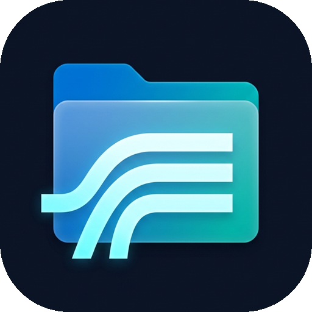

<p align="center">
  
</p>

<h1 align="center">TidyFlow</h1>

<p align="center">
  A fast, open-source Windows desktop utility to <strong>organize messy folders</strong>, <strong>batch-rename files from custom lists</strong>, <strong>remove duplicate files</strong>, and <strong>clean up disk space</strong> — with mandatory Live Preview and safe Undo / Recycle Bin protection.
</p>

---

## Features

- **Organize Folder:** Sort cluttered directories (`Downloads`, etc.) into clean subfolders by file category, date (`YYYY-MM`), or custom rules with **`MatchAny (OR)` / `MatchAll (AND)`** logic and **minimum file age** filters.
- **List-Based Batch Rename:** Add or drag-and-drop files from Explorer, reorder them, rename 1-to-1 from a pasted/saved list of names, and optionally move renamed files into a chosen output folder (`Save to:`).
- **Quick Template Rename:** Format names with `{index}`, `{name}`, `{date}`, `{exif_date}`, `{ext}`, Find & Replace, and duplicate marker cleanup (`(1)`, `Copy of`).
- **Duplicate File Finder:** Fast size + **SHA-256** content scan with one-click *Keep Oldest* / *Keep Newest* presets and safe **Recycle Bin** cleanup.
- **Space & Clutter Cleaner:** Find the top 100 largest files, inspect subfolder usage, and remove nested empty folders safely.
- **Bulk Image Resizer & Converter:** Resize by width, height, fit-box, or percentage and convert across `JPG`, `PNG`, `BMP`, `TIFF`.
- **Background Watch Folder & Explorer Menu:** Minimize to System Tray to auto-organize newly downloaded files, plus 1-click per-user Windows Explorer right-click integration (`--organize` / `--rename`).
- **Smart OCR & AI Organize:** Extract text from screenshots/documents via built-in **Windows Native OCR** to suggest filenames (`OCR Suggest`), and organize folders with plain-English prompts (offline heuristic or local Ollama / OpenAI-compatible API) — always previewed and 1-click Undoable.
- **Live Preview & 1-Click Undo:** Inspect every `Current -> New` change before applying, with persistent JSON transaction rollback for moves & renames.
- **Multi-Language UI & About Guide:** Instant switching between **English**, **Tiếng Việt**, and **日本語** (persisted automatically), plus a built-in **About / Info** dialog with quick feature guide and GitHub links.
- **Auto-Updates:** Built-in updates via GitHub Releases powered by **Velopack**.

---

## Download & Install (Windows)

Grab the latest build from the **[Releases](https://github.com/16521803-star/TidyFlow/releases)** page:
- **Installer (`TidyFlow-win-Setup.exe`):** Recommended — installs TidyFlow with Desktop & Start Menu shortcuts and enables 1-click in-app updates.
- **Portable (`TidyFlow-win-x64-portable.exe`):** Single-file executable; download and run directly without installing.

---

## Project Structure

```text
assets/                 # App logo PNG & multi-resolution Windows ICO
scripts/                # Local packaging helper (pack-local.ps1)
src/
  TidyFlow.Core/        # Pure C# organizing, renaming, duplicate, cleaner & safety engine
  TidyFlow.App/         # Windows WPF + WPF-UI desktop application + Velopack
tests/
  TidyFlow.Core.Tests/  # xUnit unit tests
```

---

## Building from Source

### Prerequisites
- Windows 10 / 11
- [.NET 8 SDK](https://dotnet.microsoft.com/download/dotnet/8.0)

### Commands
```powershell
dotnet restore
dotnet build --configuration Release
dotnet test --configuration Release
dotnet run --project src/TidyFlow.App
```

### Publish Portable `.exe` & Windows Installer Locally
```powershell
dotnet tool install -g vpk
.\scripts\pack-local.ps1 -Version 0.7.0
```

### Build Microsoft Store `.msix` Package (No Visual Studio Required)
After reserving your app in **Microsoft Partner Center**, pass your assigned `Package/Identity/Name` and `Publisher` to `pack-msix.ps1`:
```powershell
.\scripts\pack-msix.ps1 `
  -Version 0.7.0 `
  -PackageName "HLTPRODEV.TidyFlow-SmartFileOrganizer" `
  -Publisher "CN=YOUR-PARTNER-CENTER-PUBLISHER-GUID" `
  -PublisherDisplayName "HLTPRODEV" `
  -AppDisplayName "TidyFlow - Smart File Organizer"
```
This outputs `publish/msix/TidyFlow-0.7.0-x64.msix` ready to upload to Partner Center (alongside `PRIVACY.md` and `packaging/store-listings/Logo300x300.png` / `Logo1000x1000.png`).

### Creating a New GitHub Release
Push a version tag matching `v*` to trigger [release.yml](.github/workflows/release.yml):
```powershell
git tag v0.7.0
git push origin v0.7.0
```

---

## License

[MIT](LICENSE)
